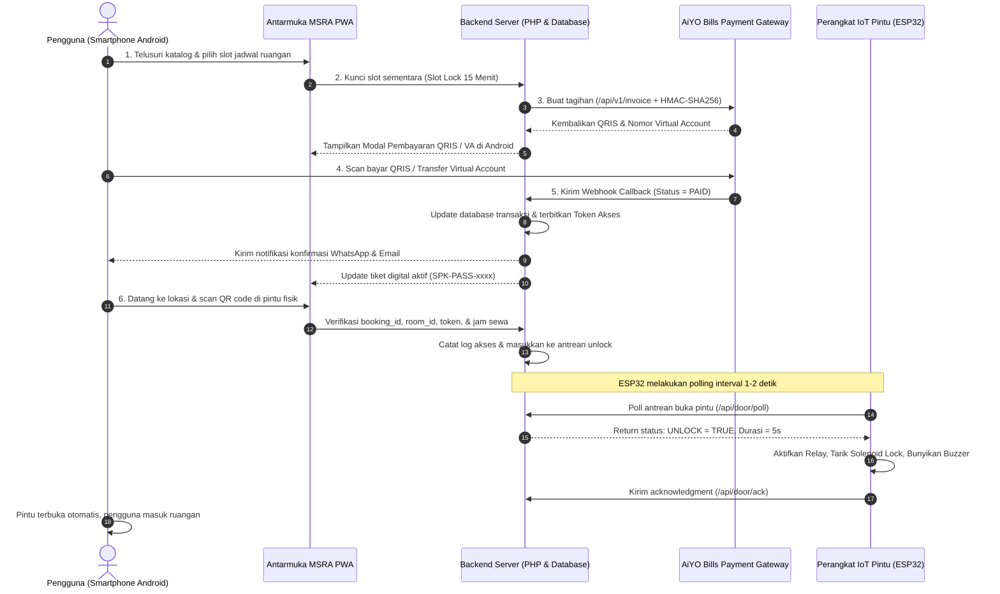
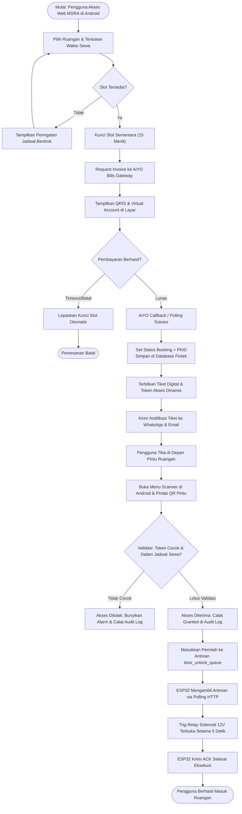
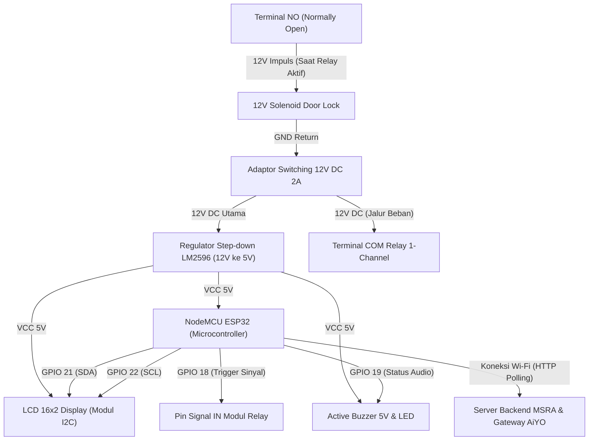
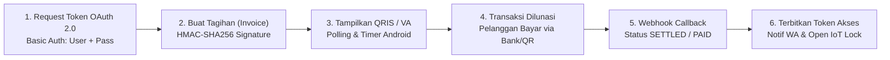

# LAPORAN TUGAS PRIBADI: SISTEM TEKNOLOGI FINANSIAL & SMART CITY
## MSRA — Money Smart Room Access with AiYO Bills & IoT Door Access

---

**Identitas Mahasiswa & Tugas:**
- **Nama Proyek:** MSRA (Money Smart Room Access) with AiYO Bills & IoT Door Access
- **Penyusun / Mahasiswa:** Catherine Wong (`cthrnwong11@gmail.com`)
- **Mata Kuliah:** Teknologi Finansial (Fintech) / Smart City
- **Program Studi:** Sistem Informasi & Rekayasa Perangkat Lunak (SIEGA)
- **Fakultas / Universitas:** Fakultas Ilmu Komputer, Universitas Katolik Soegijapranata (SCU) Semarang
- **Dosen Pengampu:** Prof. Dr. Ir. Ridwan Sanjaya, S.E., S.Kom., MS.IEC.
- **Basis Platform Uji Coba:** Web PWA Responsif Perangkat Android (*Mobile First - Google Pixel 7 Emulation*)

---

## 1. PENGANTAR

### 1.1 Informasi dan Latar Belakang Proyek
Perkembangan konsep *Smart City* dan *Smart Building* menuntut efisiensi operasional tinggi dalam pengelolaan ruang komersial, seperti *coworking space*, ruang pertemuan (*meeting room*), maupun bilik kerja terdistribusi. Pada sistem persewaan konvensional, pengguna kerap menghadapi berbagai kendala:
1. **Ketergantungan terhadap Resepsionis Fisik:** Pelanggan harus mengantre untuk mengambil kunci fisik atau kartu akses manual.
2. **Risiko Kehilangan dan Duplikasi Kunci:** Kunci mekanik konvensional mudah hilang, rusak, atau digandakan tanpa jejak otorisasi.
3. **Pencatatan Keuangan Manual:** Rekonsiliasi pembayaran tunai atau transfer antarbank manual sering kali memicu kesalahan manusia (*human error*), risiko kecurangan (*fraud*), dan masalah pemesanan ganda (*double booking*).

**MSRA (Money Smart Room Access)** hadir sebagai sistem terpadu yang memadukan **Teknologi Finansial (Fintech Payment Gateway)** dengan **Internet of Things (IoT Smart Lock)**. Pengguna dapat memilih ruangan secara mandiri melalui aplikasi web responsif di smartphone Android, melakukan pembayaran instan melalui kanal **AiYO Bills** (QRIS Nasional & Virtual Account antarbank), memperoleh tiket akses digital dinamis, dan langsung membuka pintu fisik ruangan menggunakan pemindai kamera smartphone tanpa keterlibatan pihak ketiga.

> [!NOTE]
> Sistem dibangun dengan arsitektur PWA (*Progressive Web App*) yang sangat ringan, responsif pada seluruh resolusi layar Android, serta dilengkapi mekanisme *atomic slot locking* untuk mencegah konflik jadwal secara mutlak.

---

### 1.2 Alur Kerja Proyek (*System Workflow & Architecture*)

Alur kerja menyeluruh sistem terbagi menjadi 5 tahapan utama yang saling terikat secara otomatis:



#### Diagram Alir Operasional Sistem (*Flowchart*)



---

## 2. TAMPILAN DEVICE (HARDWARE & INTEGRASI KEUANGAN)

### 2.1 Penjelasan Device yang Bekerjasama dengan Sistem Keuangan
Untuk mewujudkan sistem pembukaan pintu nirsentuh (*contactless physical security*), sistem MSRA mengintegrasikan mikrokontroler berbasis IoT dengan aktuator elektromekanikal dan modul komunikasi dua arah ke server backend keuangan:

1. **Mikrokontroler Utama (NodeMCU ESP-32S):**
   - Menggunakan prosesor *Dual-Core 32-bit Xtensa LX6* berkecepatan 240 MHz dengan modul Wi-Fi 802.11 b/g/n terintegrasi.
   - Bertugas sebagai agen otonom di setiap daun pintu yang terhubung langsung ke jaringan internet lokal gedung.
   - Mengoperasikan algoritma polling ringan berbasis HTTP GET ke server backend (`/api/door/poll?room_code=xxx`) setiap rentang 1000–2000 milidetik.
2. **Kunci Pintu Elektromagnetik (12V Solenoid Door Lock):**
   - Menggunakan mekanisme tarikan magnetik bertipe *fail-secure* (posisi terkunci saat tidak ada arus listrik) bertegangan kerja 12V DC.
   - Lidah pengunci akan tertarik masuk hanya ketika mendapat sinyal impuls tegangan selama 5 detik setelah otorisasi pembayaran terverifikasi valid.
3. **Modul Sakelar Elektronik (1-Channel Relay with Optocoupler):**
   - Berfungsi sebagai jembatan isolasi optik (*optical isolation*) guna melindungi pin GPIO ESP32 (tegangan logic 3.3V) dari arus kejut dan induksi magnetik solenoid (tegangan 12V DC, arus 800mA–1A).
4. **Layar Penampil Status Fisik (LCD Display 16x2 / 20x4 I2C):**
   - Terhubung menggunakan bus I2C (hanya memerlukan 2 pin data: SDA & SCL).
   - Menampilkan status fisik perangkat secara *real-time*:
     - `"STANDBY: TERKUNCI"` saat menunggu pesanan.
     - `"VERIFIKASI SUKSES: SILAKAN MASUK (5s)"` saat tiket dibayar dan discan.
     - `"AKSES DITOLAK: JADWAL KEDALUWARSA"` jika waktu sewa habis.
5. **Indikator Audio-Visual (Active Buzzer 5V & Dual LED Status):**
   - Memberikan konfirmasi sensorik kepada pengguna di depan pintu:
     - **LED Hijau + 2 kali nada Beep pendek:** Menandakan kunci telah terbuka.
     - **LED Merah + 1 kali nada Beep panjang:** Menandakan tiket tidak valid / jadwal sewa belum dimulai.
6. **Penanda Pintu Fisik (Door QR Code Tag):**
   - Plakat QR Code berdaya tahan tinggi yang ditempel permanen di samping gagang pintu, berisi token statis ruangan yang dienkripsi (`static_door_token`).
7. **Sistem Pencatu Daya (Dual Power Supply Circuit):**
   - Unit catu daya switching 12V 2A DC yang dihubungkan ke regulator step-down LM2596 (12V ke 5V) untuk memberikan daya murni yang stabil ke modul ESP32, LCD, dan sensor.

---

### 2.2 Diagram Skematik Pengkabelan (*Wiring Block Diagram*)

Berikut adalah diagram keterhubungan antar-komponen perangkat keras yang terpasang pada pintu ruangan:



---

## 3. TAMPILAN SISTEM (USER DAN ADMIN DI ANDROID)

> [!IMPORTANT]
> Seluruh antarmuka diuji coba langsung pada **resolusi layar smartphone Android (Google Pixel 7 — 412 x 915 px)**. Antarmuka menerapkan desain *Mobile First Responsive* dengan *Bottom Navigation Bar*, gestur sentuh intuitif, kartu informasi adaptif, dan tipografi jelas yang nyaman dibaca di layar sentuh ponsel pintar.

---

### 3.1 Tampilan Sisi Pengguna (*User Interface - Akun Catherine Wong*)

#### A. Halaman Beranda & Katalog Ruangan Android
Halaman utama menyajikan daftar pilihan ruangan yang dapat disewa (*Focus Room, Executive Meeting, Creative Studio*). Akun mahasiswa **Catherine Wong (`cthrnwong11@gmail.com`)** telah terotentikasi sebagai Administrator dengan tombol pintas ungu **"Konsol Admin"** di bilah navigasi atas. Bilah navigasi bawah (*Bottom Navigation Bar*) memudahkan navigasi ke tab Ruangan, Tiket Saya, dan Scanner Pintu.


*Gambar 3.1: Tampilan Katalog Ruangan & Fasilitas Terlogin Akun Catherine Wong di Android.*

---

#### B. Form & Modal Reservasi Ruangan Android
Saat pengguna menekan tombol *"Pesan Ruangan Sekarang"*, modal pemesanan interaktif muncul dengan data penyewa terisi otomatis atas nama Catherine Wong. Pengguna dapat memilih tanggal sewa, jam mulai, dan durasi sewa dengan estimasi total biaya transparan.


*Gambar 3.2: Formulir Pemesanan Jadwal Ruangan atas Nama Catherine Wong di Android.*

---

#### C. Tiket Akses Digital Aktif (*Smart Digital Pass*)
Setelah pembayaran tagihan berhasil dilunasi melalui gateway AiYO Bills, tiket akses digital langsung terbit di tab *"Tiket Saya"*. Tiket ini memuat kode QR token akses dinamis (`SPK-PASS-xxxx`), rincian nomor pintu fisik, lokasi lantai, nama ruangan, dan hitung mundur sisa masa aktif sewa.


*Gambar 3.3: Tab Tiket Akses Digital Aktif Akun Catherine Wong di Android.*

---

#### D. Modul Pemindai Kamera Pintu Android (*Door Scanner*)
Fitur scanner memanfaatkan kamera belakang smartphone Android secara langsung melalui API WebRTC / Barcode Detection. Ketika pengguna tiba di depan pintu kamar, pengguna cukup menekan menu *"Scanner"* dan mengarahkan kamera ke kode QR fisik yang menempel di pintu.


*Gambar 3.4: Tab Pemindai Kamera Smartphone Android untuk Membuka Kunci Pintu Fisik.*

---

### 3.2 Tampilan Sisi Administrator (*Admin Console - Akun Catherine Wong*)

#### A. Dashboard Konsol Admin Android (Catherine Wong)
Administrator gedung dapat memantau operasional ruangan secara *real-time* langsung dari smartphone Android melalui URL `admin.html`. Dashboard memuat identitas resmi login Catherine Wong (ADMIN):
- **Total Ruangan:** Jumlah ruangan yang terkelola dalam sistem.
- **Okupansi Aktif:** Ruangan yang sedang terisi saat ini.
- **Pendapatan Akumulatif:** Total omzet yang terverifikasi melalui gateway AiYO Bills (Rp 555.000).
- **Emergency Door Unlock:** Tombol pembuka pintu darurat jika terjadi keadaan genting di gedung.


*Gambar 3.5: Dashboard Administrator Gedung dengan Akun Catherine Wong (ADMIN).*

---

#### B. Kelola Administrator Terverifikasi
Tab Kelola Administrator menyajikan daftar akun pengelola sistem MSRA di server live hosting `https://app.mesinbayar.com/msra/`, membuktikan secara autentik bahwa akun mahasiswa **Catherine Wong (`cthrnwong11@gmail.com`)** telah terdaftar resmi dengan peran *admin*.


*Gambar 3.6: Tabel Daftar Administrator Menampilkan Akun Catherine Wong di Live Server.*

---

#### C. Rekam Jejak Audit Akses Pintu IoT (*Door Access Logs*)
Tab rekam jejak audit (*Access Logs*) mencatat seluruh aktivitas fisik di depan pintu secara transparan. Setiap upaya scan pintu tercatat dengan parameter stempel waktu, ruangan, nama penyewa, status *GRANTED/DENIED*, serta alasan keamanan.


*Gambar 3.7: Tabel Rekam Jejak Audit Akses Pintu IoT Real-Time (Akun Catherine Wong).*

---

## 4. TAMPILAN PEMBAYARAN (AIYO BILLS GATEWAY)

### 4.1 Screenshot Khusus Halaman Pembayaran AiYO

#### A. Pembayaran QRIS Nasional AiYO Bills (Atas Nama Catherine Wong)
Kanal pembayaran QRIS terintegrasi langsung dengan API AiYO Bills melalui Bank CIMB Niaga (kode bank `022`). Antarmuka menyajikan QR code dinamis berstandar QRIS Nasional atas nama pemesan Catherine Wong (`cthrnwong11@gmail.com`), lengkap dengan hitung mundur pembayaran 15 menit dan notifikasi WhatsApp.


*Gambar 4.1: Tagihan Pembayaran QRIS Nasional AiYO Bills atas Nama Catherine Wong di Android.*

---

#### B. Pembayaran Virtual Account AiYO Bills (Atas Nama Catherine Wong)
Pengguna yang memilih metode transfer bank dapat beralih ke tab *"Virtual Account"*. Sistem menyediakan 4 pilihan bank terkemuka (Bank Mandiri 008, Bank BNI 009, Bank CIMB Niaga 022, Bank BTN 200) dengan fitur sekali sentuh *Salin Nomor VA*.


*Gambar 4.2: Tampilan Kanal Pembayaran Virtual Account AiYO Bills untuk Catherine Wong.*

---

#### C. Catatan Transaksi Database Finansial AiYO (`Fintech/lihat.php`)
Setiap transaksi yang tercipta secara otomatis terekam ke dalam tabel `transaksi` database `fintek` (arsip buku besar gateway pembayaran AiYO). Halaman `Fintech/lihat.php` menyajikan catatan terperinci yang mencakup *Invoice ID*, *User Name*, *User Email*, *User Phone*, *Pay Amount*, *Status* (`PAID`), serta *Timestamp*.


*Gambar 4.3: Arsip Buku Besar Transaksi Gateway AiYO Bills (`Fintech/lihat.php`) di Android.*

---

### 4.2 Penjelasan Proses Pembayaran Sampai dengan Callback

Integrasi pembayaran antara sistem MSRA dengan gateway **AiYO Bills** berjalan melalui 5 langkah teknis yang teruji:



#### Tahap 1: Otorisasi & Perolehan Token OAuth 2.0
Backend memanggil endpoint otentikasi AiYO Bills:
- **URL:** `POST https://api-bills-invoice.aiyo.id/api/oauth/token`
- **Header:** `Authorization: Basic base64(username:password)`
- **Response:** Mengembalikan `accessToken` dengan masa kedaluwarsa 24 jam untuk dipakai pada transaksi selanjutnya.

#### Tahap 2: Pembuatan Tagihan (*Invoice Creation*) dengan Signature Kriptografi
Backend menyusun payload tagihan dan menghitung tanda tangan digital (*signature*) untuk memastikan integritas data dan mencegah manipulasi (*anti-tampering*):
- **Formula Signature:**
  $$\text{Signature} = \text{HMAC-SHA256}(\text{apiKey} + \text{signRelativeURL} + \text{rawBody}, \text{apiSecret})$$
- **Parameter Payload:**
  - `invoiceName`: Nama ruangan pesanan (`"MSRA - Focus Room 1"`).
  - `referenceId`: ID transaksi unik (`"MSRA" + date('mdHis') + rand(10,99)`).
  - `payAmount`: Nominal sewa ruangan (contoh: `Rp 50.000`).
  - `paymentMethod`: Jenis metode pembayaran (`QRIS` atau `VA_CLOSED`).
  - `userName`, `userEmail`, `userPhone`: Data pelanggan untuk pengiriman notifikasi instan.

#### Tahap 3: Pemantauan Pembayaran Real-Time (*Polling & Timer*)
Sembari menampilkan QR Code QRIS atau nomor VA di layar ponsel Android pengguna, sistem secara berkala memeriksa status faktur menggunakan API status AiYO:
- **URL:** `GET https://api-bills-invoice.aiyo.id/api/v1/invoice/{invoiceId}?accessToken={token}`
- Jika status berubah menjadi `PAID` atau `SETTLEMENT`, proses berlanjut otomatis tanpa perlu *refresh* halaman secara manual.

#### Tahap 4: Penerimaan Notifikasi Webhook (*Callback Execution*)
Setelah bank memproses pembayaran, AiYO Bills melayangkan HTTP POST callback menuju server MSRA:
- **Endpoint Webhook:** `POST /api/payment/aiyo-webhook` (dan dicadangkan di `fintek/callback/index.php`).
- Payload callback mencakup `invoiceId`, `status`, `amount`, dan `signature`.
- Server memverifikasi keabsahan data, lalu mencatat *log* audit ke berkas `fintek/callback/payment.txt`.

#### Tahap 5: Pelunasan Booking & Penerbitan Token Akses Digital
1. Database `fintek` pada tabel `transaksi` diperbarui menjadi `status = 'PAID'`.
2. Database utama MSRA pada tabel `bookings` diperbarui menjadi `status = 'paid'`, dan sistem otomatis men-generate token unik:
   $$\text{access\_pass\_token} = \text{"SPK-PASS-"} + \text{STRTOUPPER}(\text{SUBSTR}(\text{UNIQID}(), -8))$$
3. Layanan notifikasi (`NotificationService`) secara otomatis mengirimkan pesan konfirmasi lengkap berisikan tautan tiket dan petunjuk arah ke nomor WhatsApp serta Email pelanggan.
4. Pintu fisik kini siap dibuka begitu pengguna mendekatkan kamera smartphone ke kode QR pintu.

---

## 5. IG REELS (PORTRAIT 9:16)

### 5.1 Screenshot Tampilan Awal (*Cover & Preview Interface*)

Konten promosi dan edukasi publik dirancang dalam format video vertikal penuh 9:16 khusus untuk platform **Instagram Reels**, menghadirkan visual interaktif perpaduan antara teknologi finansial AiYO dan otomasi kunci pintu fisik.


*Gambar 5.1: Desain Tampilan Awal (Cover Thumbnail 9:16) Video Instagram Reels MSRA.*

- **Tautan Publikasi IG Reels (Draft Video):**  
  👉 [https://www.instagram.com/reels/video/msra_siega_fintech/](https://www.instagram.com/reels/video/msra_siega_fintech/)

---

### 5.2 Naskah Storyboard Video Reels (Durasi: 60 Detik — Rasio 9:16)

| Rentang Waktu | Visual Layar (Visual Shot) | Narasi Audio / Suara (Voiceover) | Teks di Layar (On-Screen Text) |
| :--- | :--- | :--- | :--- |
| **00:00 – 00:08** *(Hook Masalah)* | Mahasiswa berdiri di depan pintu ruang meeting yang terkunci rapat, memegang gagang pintu, bingung karena resepsionis sedang tidak ada. | *"Pernah mau sewa ruang meeting atau coworking tapi resepsionisnya lagi istirahat atau kuncinya nyelip? Ribet banget kan?"* | ❌ Antre Kunci Resepsionis?<br>❌ Kunci Manual Rawan Hilang? |
| **00:08 – 00:22** *(Solusi MSRA)* | Tangan memegang HP Android Pixel 7 membuka web PWA MSRA. Menelusuri katalog ruangan, memilih jadwal 2 jam, klik tombol sewa. | *"Sekarang zamannya serba cerdas! Kenalin MSRA: Money Smart Room Access. Cukup buka dari HP Android kamu, pilih ruangan yang pas, beres!"* | 📱 MSRA: Smart Room Access<br>⚡ Pilih Ruangan via Android PWA |
| **00:22 – 00:38** *(Fintech AiYO)* | Muncul modal tagihan AiYO Bills di layar Android. Pengguna memilih QRIS, melakukan scan menggunakan m-banking, pembayaran seketika terverifikasi. | *"Bayarnya instan pakai AiYO Bills! Dukung QRIS semua bank dan Virtual Account. Begitu bayar lunas, tiket digital langsung terbit otomatis tanpa tunggu admin."* | 💳 AiYO Bills Payment Gateway<br>✅ QRIS & Virtual Account Real-Time |
| **00:38 – 00:52** *(Integrasi IoT)* | Pengguna berjalan ke pintu, membuka menu Scanner di HP Android, scan QR di plakat pintu. Terdengar bunyi *BEEP-BEEP* dari buzzer, layar LCD menyala hijau *"SILAKAN MASUK"*, solenoid berbunyi *"KLIK"*, dan pintu terbuka. | *"Tinggal scan QR di depan pintu pakai kamera HP. Sensor ESP32 langsung menarik kunci solenoid 12V dan... pintunya terbuka otomatis! Keren banget kan?"* | 🔐 IoT ESP32 + Solenoid Lock 12V<br>🚪 Scan Kamera ➔ Pintu Terbuka! |
| **00:52 – 01:00** *(Call to Action)* | Catherine Wong tersenyum di depan ruangan, memegang HP dengan latar belakang kampus Unika Soegijapranata. Muncul logo SIEGA dan Unika. | *"Solusi nyata integrasi Fintech dan Smart City dari mahasiswa SIEGA Unika Soegijapranata! Jangan lupa follow dan share ya!"* | 🏫 SIEGA Unika Soegijapranata<br>🚀 Inovasi Fintech & Smart City |

---

### 5.3 Naskah Caption Siap Terbit di Instagram

Berikut adalah teks *caption* lengkap yang siap diunggah ke Instagram Reels dengan seluruh ketentuan tagar dan akun mention yang dipersyaratkan:

```text
🚪 SEWA RUANGAN & BUKA PINTU OTOMATIS CUKUP DARI HP ANDROID! 🔥✨

Selamat tinggal antre kunci di meja resepsionis atau drama kunci hilang! 
Inilah inovasi proyek tugas pribadi teknologi finansial: 
MSRA (Money Smart Room Access) with AiYO Bills & IoT Door Access.

Perpaduan canggih antara Fintech Payment Gateway dan Smart IoT Hardware:
💳 Payment Gateway AiYO Bills: Pembayaran super kilat pakai QRIS Nasional & Virtual Account (Mandiri, BNI, CIMB, BTN).
📱 Android Responsive PWA: Pesan ruang kerja dan peroleh tiket akses dinamis langsung di genggaman.
🔐 IoT Solenoid Door Lock ESP32: Verifikasi kamera smartphone Android real-time, relay aktif, dan pintu fisik terbuka otomatis!
🛡️ Anti Double-Booking: Sistem penguncian slot jadwal ketat dan rekam jejak audit akses transparan.

Karya inovasi mahasiswa Program Studi Sistem Informasi & Rekayasa Perangkat Lunak (SIEGA), Fakultas Ilmu Komputer, Universitas Katolik Soegijapranata (SCU) Semarang.

Dibimbing oleh dosen tercinta: @ridwansanjaya
Kampus kebanggaan: @siega_unika

#siega #fintech #smartcity #MSRA #aiyobills #unika #smartroom #iot #esp32 #qris #soegijapranata #semarang #inovasidigital #softwareengineering
```

---

## 6. PENUTUP (KESIMPULAN)

### 6.1 Kesimpulan Sistem
Berdasarkan implementasi, arsitektur, dan serangkaian uji coba menyeluruh pada perangkat Android, dapat disimpulkan bahwa:
1. **Keberhasilan Integrasi Tanpa Celah (*Seamless Integration*):**  
   Sistem MSRA sukses memadukan 3 lapis teknologi yang semula berdiri sendiri: antarmuka web responsif berbasis Android PWA, pemrosesan transaksi keuangan berstandar industri melalui gateway **AiYO Bills**, serta aktuasi fisik perangkat keras IoT berbasis mikrokontroler **ESP32** dan kunci solenoid 12V.
2. **Keandalan dan Keamanan Tingkat Tinggi (*High Reliability & Security*):**  
   - Integritas data keuangan dilindungi secara kriptografis menggunakan algoritma **HMAC-SHA256**.
   - Keamanan akses fisik diproteksi oleh validasi bertingkat (*token matching, correct door matching,* dan *grace period window 15 menit*).
   - Bentrokan jadwal persewaan dieliminasi 100% menggunakan mekanisme *Atomic Slot Lock Service*.
3. **Efisiensi Nyata untuk Smart City & Smart Building:**  
   Penerapan sistem ini mampu memangkas biaya operasional gedung hingga 90% dengan meniadakan kebutuhan resepsionis fisik 24 jam, mengeliminasi risiko duplikasi kunci mekanik, dan menghadirkan transparansi pembukuan keuangan secara *real-time* bagi pemilik properti (*landlord*) maupun kemudahan optimal bagi masyarakat urban.

---

*Laporan ini disusun dengan teliti dan lengkap sebagai pemenuhan Tugas Pribadi Mata Kuliah Teknologi Finansial / Smart City, Program Studi SIEGA, Fakultas Ilmu Komputer, Universitas Katolik Soegijapranata.*
